# Smart Fish Tank

A research aquarium at the University of Rhode Island's CYPHER Lab, built
around two Raspberry Pi 5s: one **watches the fish** with a USB camera and
YOLOv8, the other **feeds them** with a 3D-printed, stepper-driven drum feeder
that anyone on the lab network can trigger from a phone. Every printed part was
designed parametrically in code (KCL in Zoo Design Studio), geometry-checked in
Python before printing, printed in PETG, and assembled and tested by hand
against the real hardware.


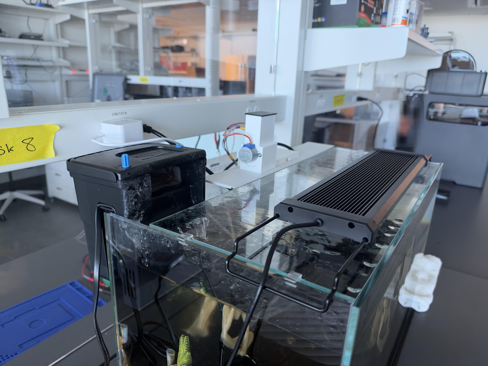

*The real thing: LANDEN 60P rimless tank, printed rear cover plate, feeder drum
and 28BYJ-48 motor on the back, Pi power supply on the shelf.*

## Status at a glance

| Piece | State |
|---|---|
| Auto feeder (drum, hopper, ramp inserts, plate, saddle) | **Built and running** on the tank |
| `feeder.py` with position memory and daily limit | **Running**, homing repeatable at 2.5 ms/step |
| Phone feed page over Tailscale (`app.py`, systemd service) | **Running** |
| Vision Pi: MJPEG stream + YOLOv8 fish detection | **Running** (first camera position; new mount pending) |
| Camera mount v5 (desk clamp, telescoping post, dock) | Designed, ready to print |
| ESP32 water-quality node (temperature, pH, level) | **Planned**, spec in [`esp32/`](esp32/README.md) |
| ESP32 camera pan head | Designed concept, after the mount is printed |
| Fish-health classifier (ELE 588 project) | In progress |
| Cloud coordination across nodes | Roadmap |

## System overview

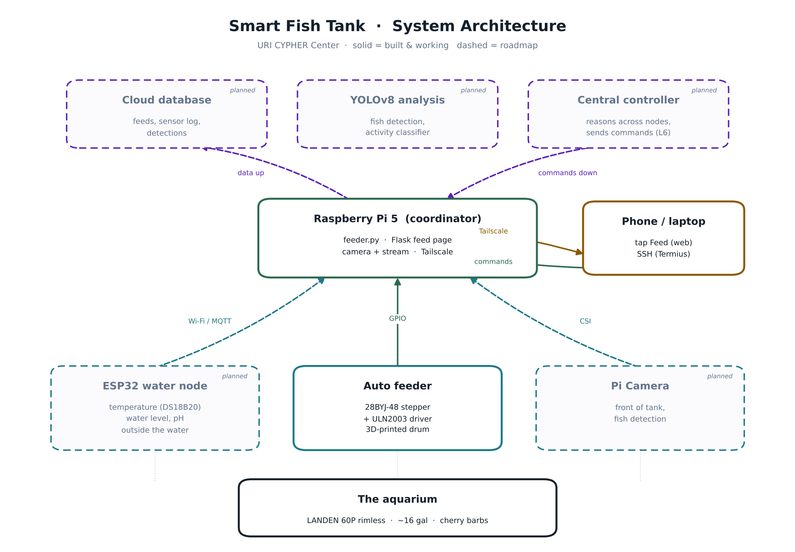

Solid blocks are built; dashed blocks are the roadmap. In IoT-maturity terms the
system today is a single edge node with local control and remote access. The
roadmap adds independent sensing and camera nodes and moves the database and
controller logic to the cloud, which is what pushes it toward a multi-node level.

### 3D layout, including the planned ESP32 nodes

[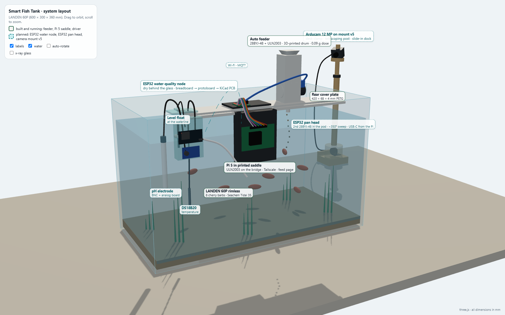](https://mubarizsaeed.github.io/smart-fish-tank/docs/esp32_node_3d.html)

**[Open the interactive version](https://mubarizsaeed.github.io/smart-fish-tank/docs/esp32_node_3d.html)**
(three.js; drag to orbit, toggle water and labels) or open
[`docs/esp32_node_3d.html`](docs/esp32_node_3d.html) locally. Solid parts are
built; the translucent teal parts are the planned ESP32 water-quality node
behind the back glass with its three probes in the water, and the ESP32 pan head
in the base of the camera mount.

## What it does today

The tank is a LANDEN 60P rimless aquarium (600 × 300 × 360 mm, 6 mm glass,
roughly 17 gallons) stocked with eight cherry barbs. Nobody is in the lab on
weekends, so the fish needed a feeder that could be triggered remotely and
trusted to dispense the same small dose every time. The feeder also gives the
computer-vision work something it did not have before: an exact timestamp for
every feeding event, logged automatically, which becomes ground truth for
behaviour classification.

Three pieces work together:

- **Vision Pi.** A Raspberry Pi 5 with an Arducam 12 MP autofocus USB camera
  (IMX708) runs a Flask/Waitress MJPEG livestream and local YOLOv8 fish
  detection with bounding boxes drawn on the frames.
- **Feeder Pi.** A second Raspberry Pi 5, mounted in a printed saddle bracket
  that hangs off the back of the tank, drives the stepper feeder and serves a
  small Flask page so anyone on the lab's private Tailscale network can tap
  **Feed** from a phone.
- **The feeder.** A drum feeder with a fixed-volume dose pocket, turned by a
  28BYJ-48 geared stepper through a ULN2003 driver board, powered straight from
  the Pi's 5 V header. No soldering anywhere in the build.

## Hardware

| Item | Detail |
|---|---|
| Tank | LANDEN 60P, 600 × 300 × 360 mm, 6 mm glass, Seachem Tidal 35 filter |
| Fish | 8 cherry barbs (*Puntius titteya*) |
| Water testing | API freshwater liquid test kit (continuous sensing is the ESP32 plan) |
| Vision computer | Raspberry Pi 5, Arducam 12 MP autofocus USB camera (IMX708) |
| Feeder computer | Raspberry Pi 5, Raspberry Pi OS Lite 64-bit, booting from a 64 GB USB stick |
| Motor | 28BYJ-48 5 V geared stepper |
| Driver | ULN2003 breakout board, 6 female-to-female jumpers to the Pi header |
| Printed parts | Cover plate, feeder housing with hopper, drum, end cap, axle pin, saddle, ramp inserts, hopper lid |
| Fasteners | M3 × 12 self-tapping (8), M4 × 10 or M3 × 12 with shim (motor ears, 2), M2.5 × 10 with 5 mm nylon spacers (Pi, 4), M2.5 × 8 (driver, 2) |
| Remote access | SSH and Tailscale (double NAT behind the university network, so only outbound tunnels work) |

### The feeder mechanism

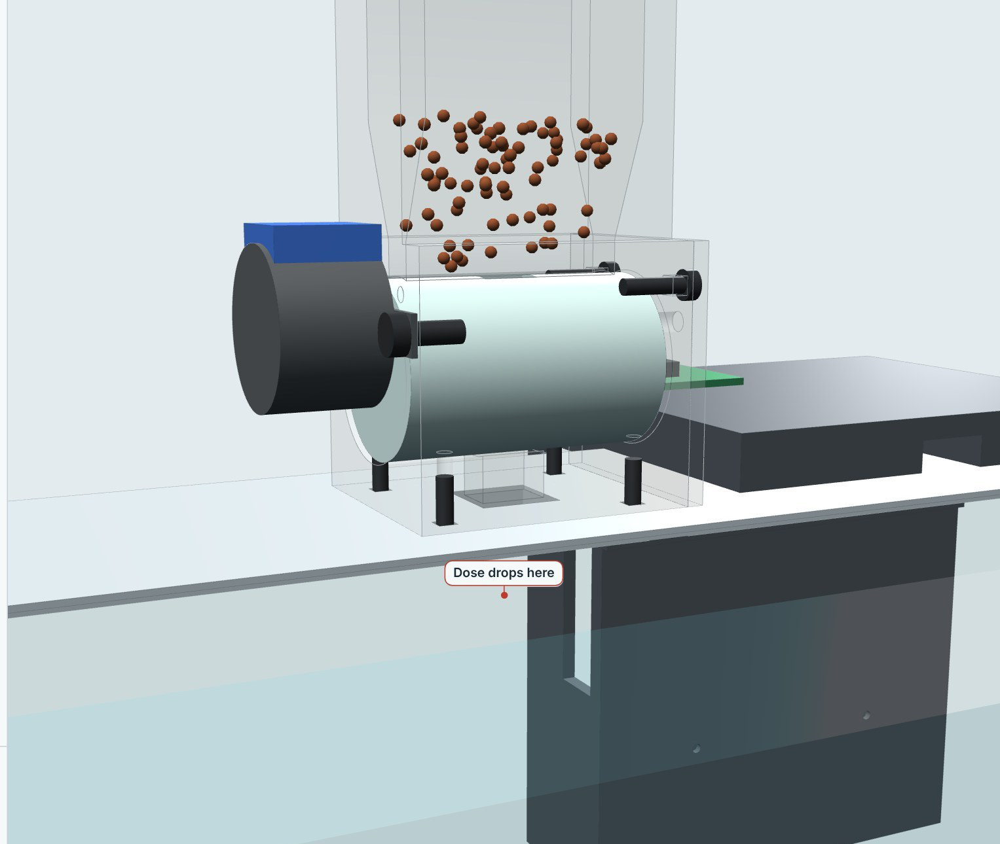

A horizontal cylinder (the drum) sits in a bore inside a printed housing with
one small square pocket cut into its surface. At rest the pocket faces up,
directly under a slot in the hopper, so it stays full of pellets. One feed is
one full rotation: the pocket turns down, dumps its pellets through a chute in
the housing floor and a matching 15 mm hole in the rear cover plate straight
into the water, then continues around and comes back to the top already
refilled. Dose size is set by the pocket volume, so every feed is the same
amount.

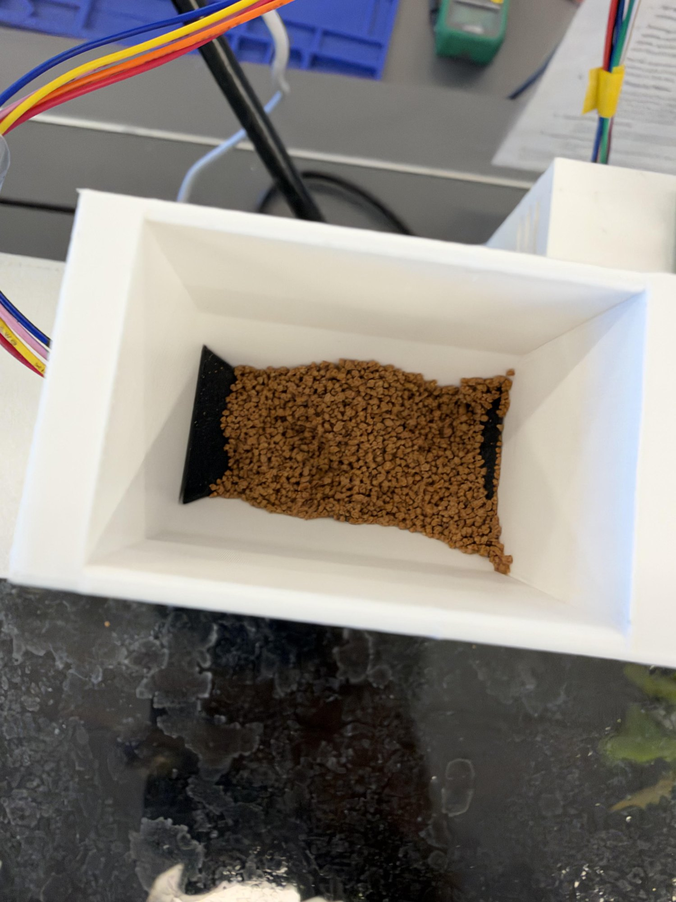

*Looking down the hopper. The two black wedges are the ramp inserts that funnel
pellets onto the 6 × 6 mm pocket instead of letting them get crushed in the
unused part of the slot.*

Key dimensions:

- Drum: 31.2 mm diameter, 48 mm long, 0.4 mm running clearance in the bore.
- Dose pocket: 6 × 6 mm, roughly **0.09 g** of micro pellets per feed. Target
  intake for eight small barbs is 0.15 to 0.3 g per day, so two feeds a day.
- Drop hole in the plate: 15 mm.
- Motor to drum: the 28BYJ-48 shaft plugs directly into a D-shaped slot in the
  drum. The shaft is offset 8 mm from the motor body centre, so the bore sits at
  Z = 26 mm to keep the motor body clear of the plate.
- Cover plate: 420 × 68 × 4 mm PETG, with a step underneath that sits on the
  rear glass and a slot for the heater cord. The whole assembly lifts off the
  tank as a single unit by the plate.

### Mounting

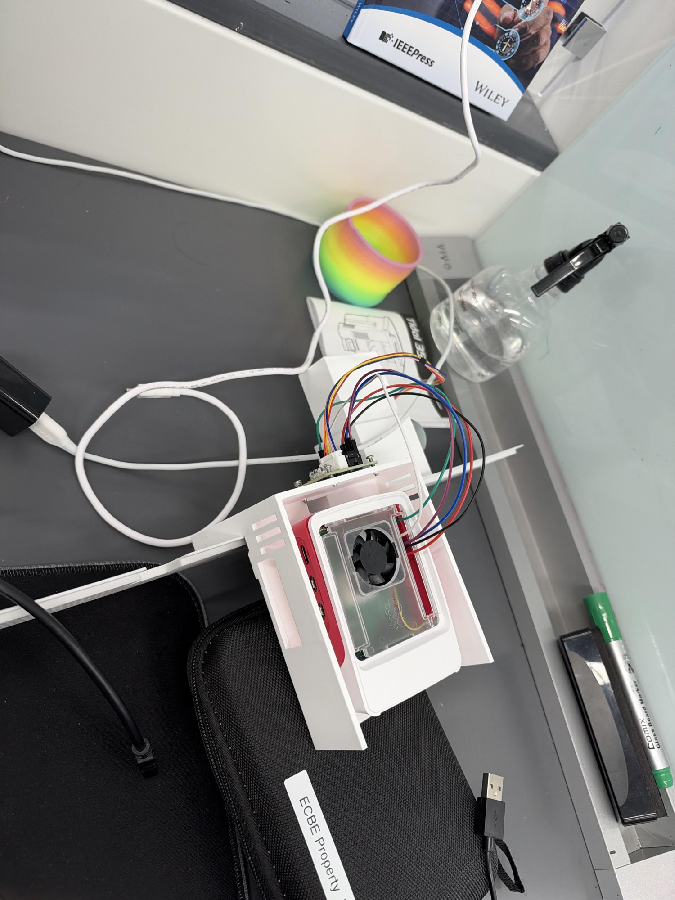

*The feeder Pi in its saddle with the ULN2003 driver screwed to the bridge,
before the saddle went onto the plate.*

The rear cover plate closes the open back strip of the rimless tank and doubles
as the feeder mount. The saddle's flat bridge sits on the plate and its tall leg
hangs past the back edge, so the Pi stays behind the glass, out of the water and
the humidity, while the drum sits over open water.

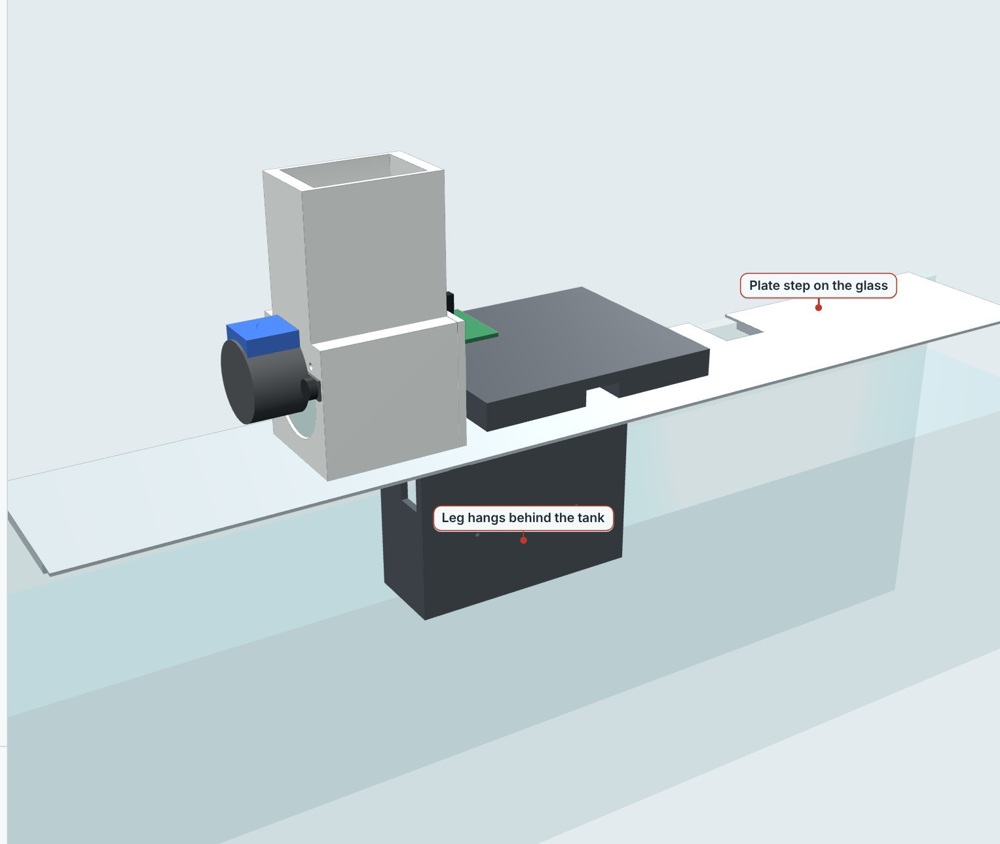

### Wiring

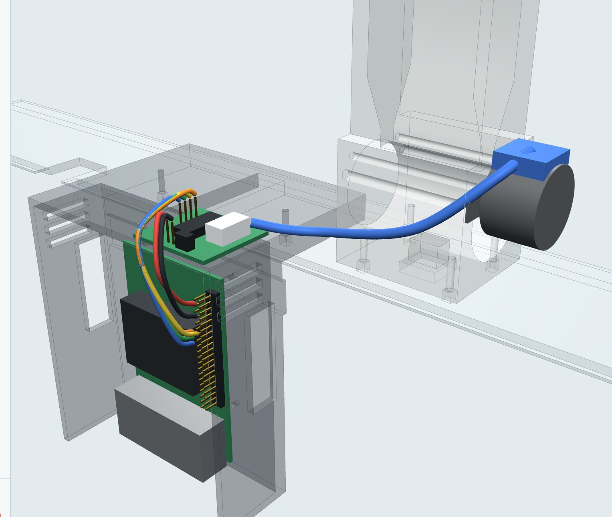

The 28BYJ-48 plugs into the ULN2003 with its own 5-pin JST connector (it only
fits one way). Six jumpers run from the driver to the Pi's 40-pin header:

| Driver pin | Pi physical pin | Signal |
|---|---|---|
| `-` | 6 | GND |
| `+` | 2 | 5 V |
| `IN1` | 11 | GPIO 17 |
| `IN2` | 12 | GPIO 18 |
| `IN3` | 13 | GPIO 27 |
| `IN4` | 15 | GPIO 22 |

Pin 1 is the corner pin at the end of the header away from the USB ports. Even
pins run down the outer row nearest the board edge, odd pins down the inner row.
Swapping `+` and `-` can destroy the driver, so check twice before power. Keep
the Pi off while wiring, then run `feeder/test.py`: it lights each driver
channel in turn, so a wrong wire is obvious before the motor ever moves. If it
buzzes but does not turn, two IN wires are swapped. If nothing happens, check
`+` and `-`.

### 3D-printed parts

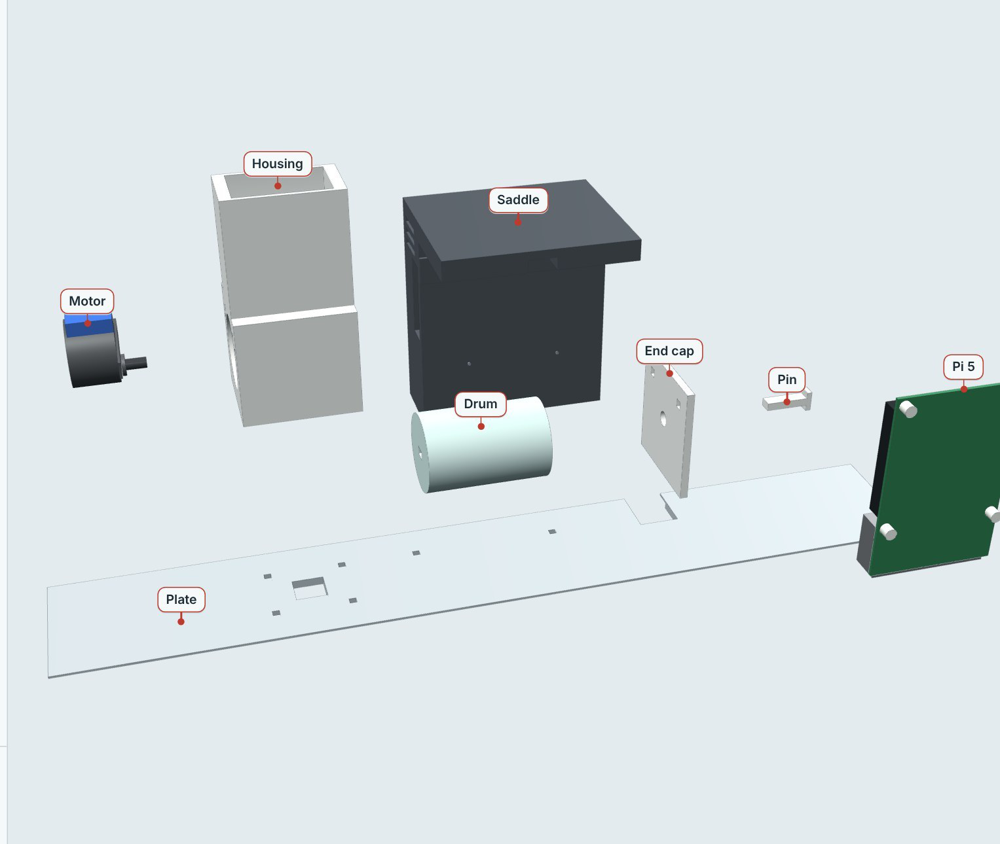

Drum, housing with fused hopper, end cap, axle pin, saddle, rear cover plate,
two hopper ramp inserts and a hopper lid, all PETG at 0.20 mm. Designed as code
in Zoo KCL, collision-checked with `manifold3d` + `trimesh` before printing
(which caught four real problems before any plastic was used), and printed on
Bambu P1S/H2D and, for the 420 mm plate, an Elegoo Orange Storm Giga.
Dimensions, print orientation, design history and the dose-sizing story are in
[`cad/README.md`](cad/README.md).

## Software

### Feeder control (`feeder/feeder.py`)

Pure `gpiozero`, no extra packages. Runs interactively over SSH on the feeder
Pi:

```bash
python3 feeder.py
```

At the `>` prompt:

| Command | Action |
|---|---|
| `Enter` | feed one dose (refuses past the daily limit) |
| `n` / `b` | nudge the drum forward / back by 1/64 turn |
| `home` | mark the current position as the top (pocket under the hopper) |
| `force` | feed, ignoring the daily limit |
| `q` / Ctrl+C | quit (motor off, position saved) |

How it works:

- **Half-step drive.** 8-step sequence, 4076 half-steps per drum turn. The
  28BYJ-48's real gear ratio is 63.68:1, not the 64:1 in most tutorials; using
  4096 would drift a few degrees every feed.
- **Speed.** 2.5 ms per step with a slow start ramp. The first version ran at
  1.5 ms and skipped steps under load, so the drum came back short of home. A
  feed takes about 12 seconds.
- **Position tracking.** Every step is counted and the phase and position are
  saved to `~/.feeder_state.json`, so the drum returns to its saved home after
  quits, reboots and power cuts. Before every feed it homes first: if the pocket
  had not yet reached the drop it backs up (food stays in the pocket); if it was
  past the drop it continues forward and refills.
- **Daily limit.** 2 feeds a day, at least 4 hours apart, read from
  `~/feed.log` (one line per feed). `force` overrides it. The log doubles as
  labelled feeding events for the vision work.
- **LED animations.** Scanner sweep, heartbeat at the drop, breathing glow on
  the driver's four LEDs, plus a fish swimming across the terminal.

**Calibration:** run the script, look down the hopper, nudge until the pocket is
centred under the slot, type `home`. Put a tape flag on the pin head, `force`
three feeds and confirm the flag returns to the same spot. Short by a few
degrees means skipped steps (slow the delay down). Off by a quarter turn or more
means the drum is slipping on the shaft (use the counterbored drum). Delete
`feed.log` afterwards so test feeds do not count against the fish.

### Phone feed page (`feeder/app.py`)

A small Flask app on the feeder Pi with a single **FEED** button wired to a
`/feed` route. It runs `feed_once.py`, which drives `feeder.py` non-interactively
so the stepper logic lives in one place, and streams the vision Pi's camera
underneath so you can watch the fish eat. It runs as the `feederweb` systemd
service (unit file in `feeder/`) so it survives reboots, and is reached over
Tailscale from any phone on the lab tailnet. `feeder/feed.timer.example` shows
the systemd timer for scheduled feeds.

```bash
STREAM_URL=http://<vision-pi>:5000/video_feed python3 app.py   # serves on :8080
```

### Vision Pi (`vision/`)

| File | What it does |
|---|---|
| `main.py` | Flask + Waitress MJPEG stream with YOLOv8 boxes drawn on every frame, plus an `/analyze-tank` route that sends three frames to GPT-4o-mini and returns a Markdown description of what each fish is doing |
| `stream.py` | Lighter stream-only server with camera reconnects, a 2-frame buffer, per-viewer quality scaling and a 5-viewer cap |
| `train.py` | Fine-tunes `yolov8n` on the tank's own frames (`config/dataset.yaml`, three classes, one per fish) |
| `fish_description.py` | One-off script: samples frames from a tank video and asks GPT-4o-mini about the decorations |
| `templates/`, `static/` | The lab-styled stream page and an "about the residents" page |

```bash
cd vision
pip install -r requirements.txt
export OPENAI_API_KEY=...        # only needed for /analyze-tank
python3 main.py                  # serves on :5000
```

On the Pi, capture runs at 640 × 480 with YOLOv8 inference on a 320 × 240 copy
every third frame to keep the Pi 5 responsive. Manual focus is locked with
`v4l2-ctl` so autofocus does not hunt through the glass; a black foam collar
pressed to the glass and a slight off-square camera angle kill reflections.
Laplacian-variance blur filtering drops soft fish crops before they go anywhere
near a classifier. Model weights and the training frames are git-ignored.

## Assembly guide

Every screw self-taps into plastic. Drive each one in, back it out, then drive
it in for real and stop at snug.

<details>
<summary>Ten steps with renders (click to expand)</summary>

1. **Slide the drum into the housing.** Pocket facing up. It should spin freely
   with a small gap all round; if it rubs, sand the drum, not the bore.
   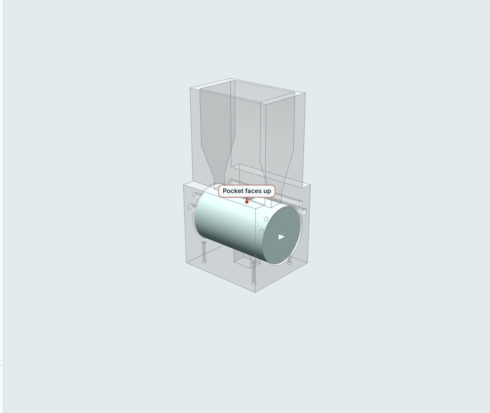
2. **Mount the motor on the left end.** Turn the drum until its slot lines up
   with the flats on the motor shaft, push the shaft in with the wire box on
   top, and screw the ears to the housing. Left means the end away from the
   saddle; on the other end the motor body would hit it.
   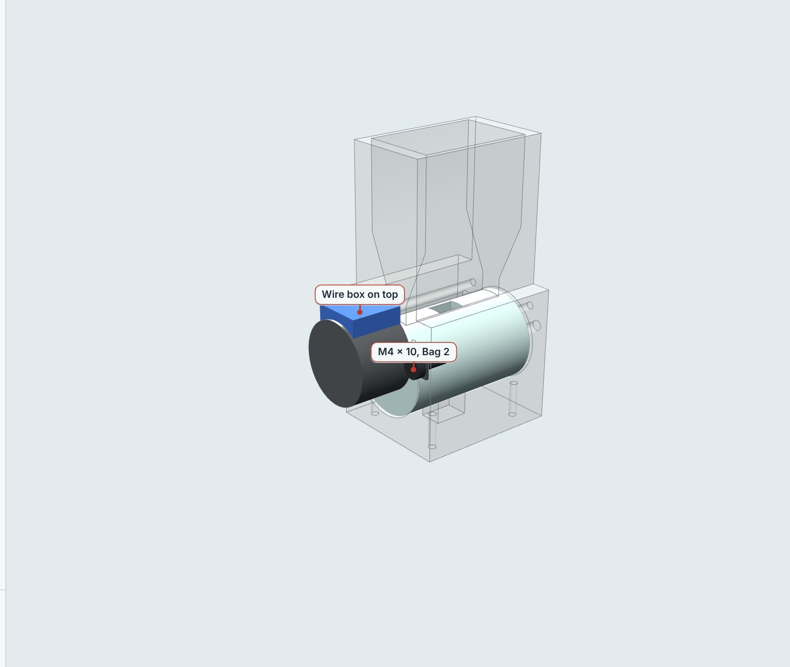
3. **Screw on the end cap.** Two M3 × 12 into the small holes near the top. The
   round centre hole is for the pin, not a screw.
   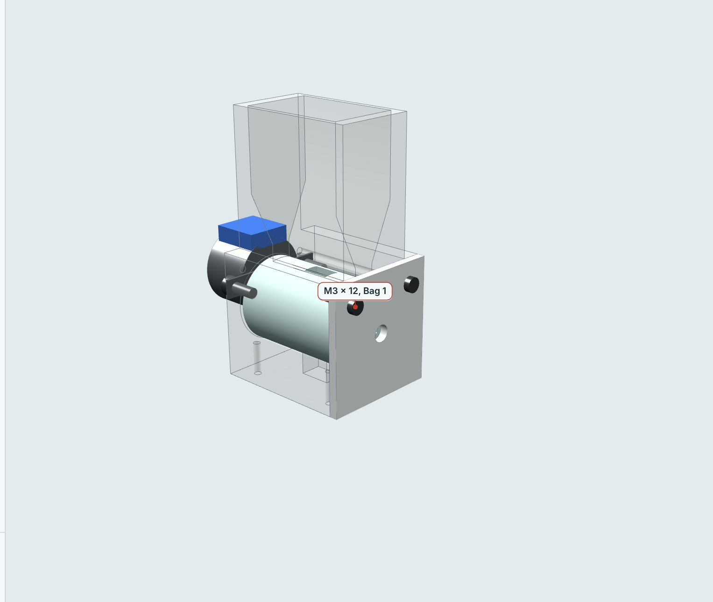
4. **Push in the pin.** Through the cap's round hole into the drum's slot until
   the head touches the cap. Drum and pin should turn together. Too loose: one
   drop of CA glue on the part inside the drum.
   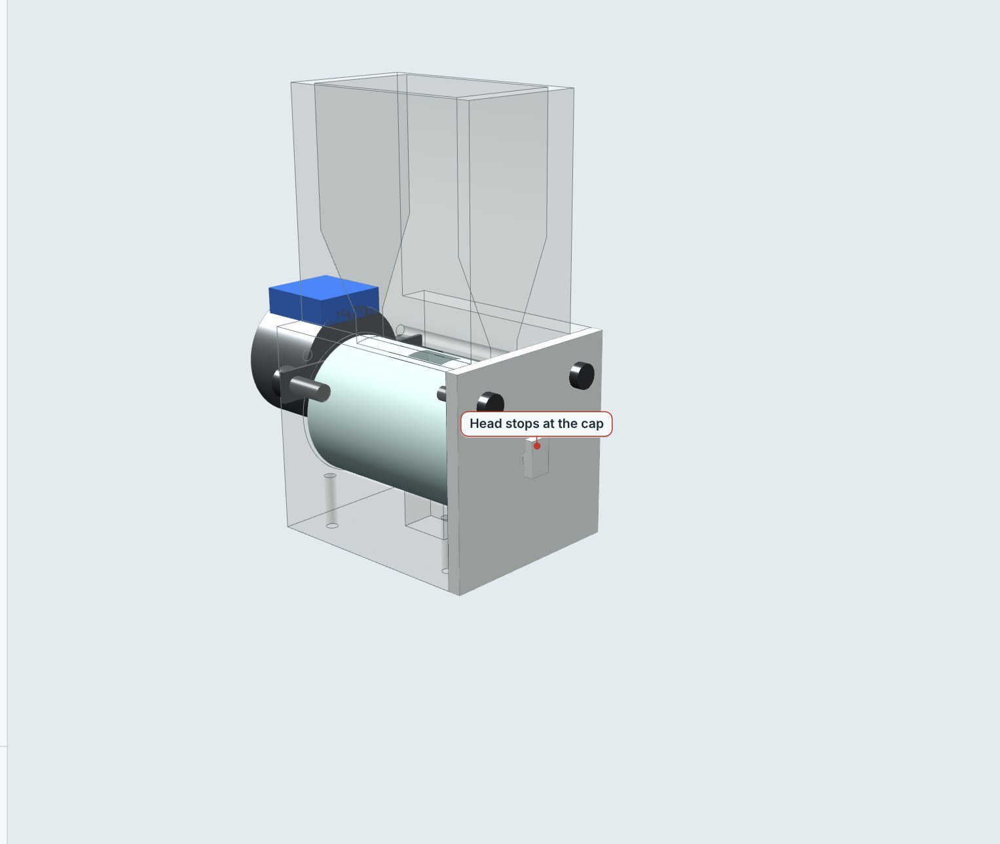
5. **Mount the feeder on the plate.** With the plate off the tank and over a
   table edge, set the chute over the plate's square hole and drive four M3 × 12
   up from underneath. Snug only; these heads hang under the plate over the
   water.
   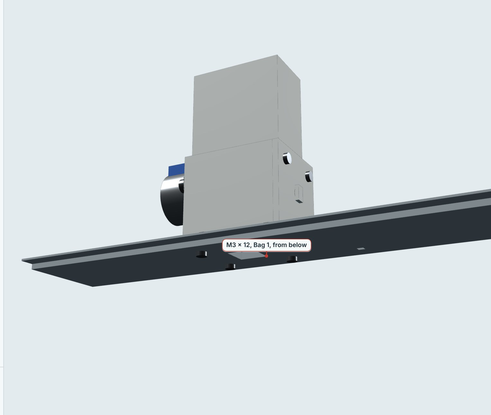
6. **Mount the saddle.** Flat bridge on the plate, tall leg hanging past the
   back edge, two M3 × 12 up from below.
   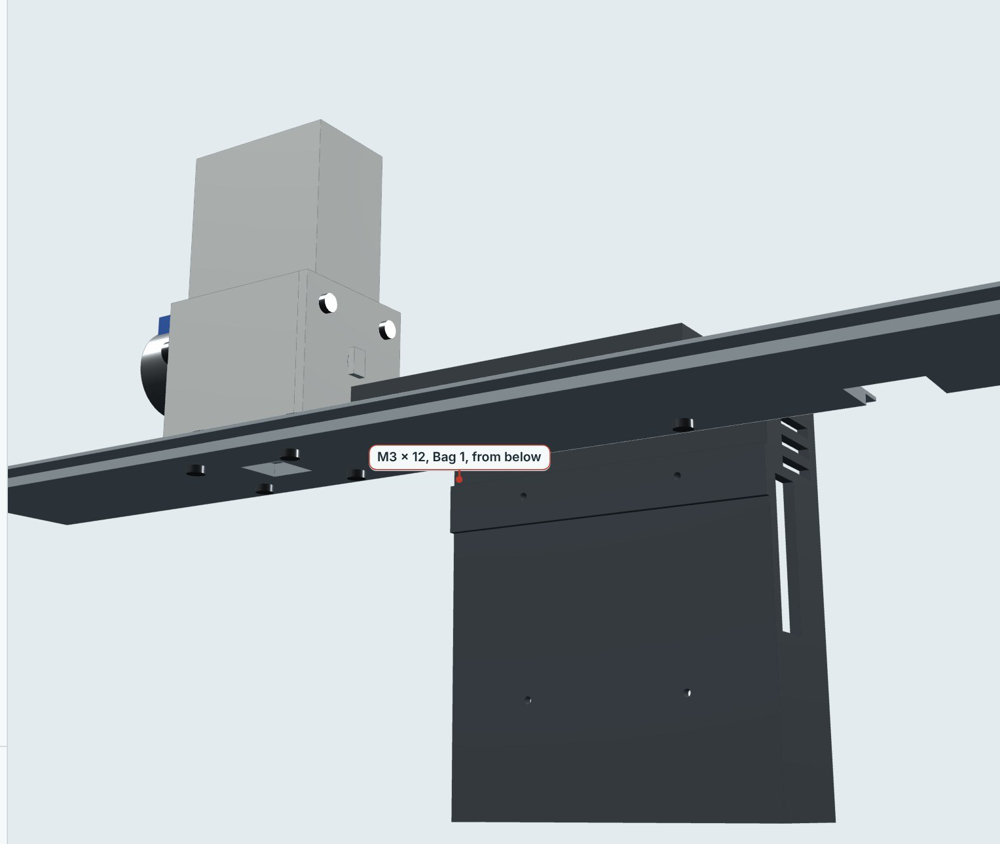
7. **Mount the Pi 5.** USB and Ethernet face down out the open bottom; USB-C and
   HDMI face the side window. A 5 mm spacer on each of the four M2.5 × 10
   screws. Anything longer than 10 mm pokes through the leg and touches the
   glass.
   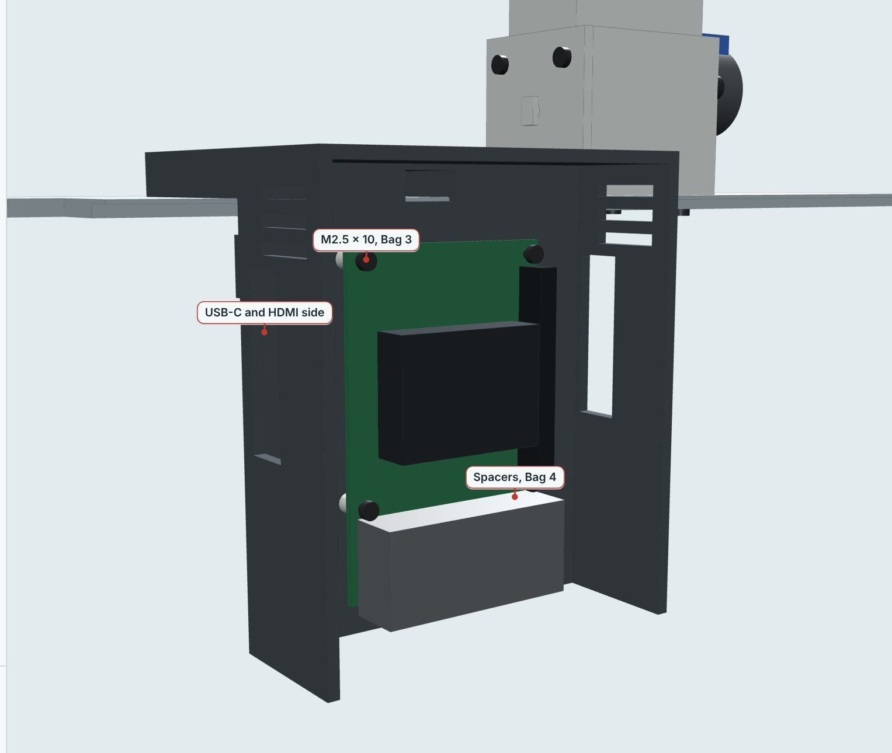
8. **Wire it up.** Driver on the back half of the saddle, motor cable behind the
   housing, six jumpers down the open back onto the Pi header. Pi off while
   wiring.
   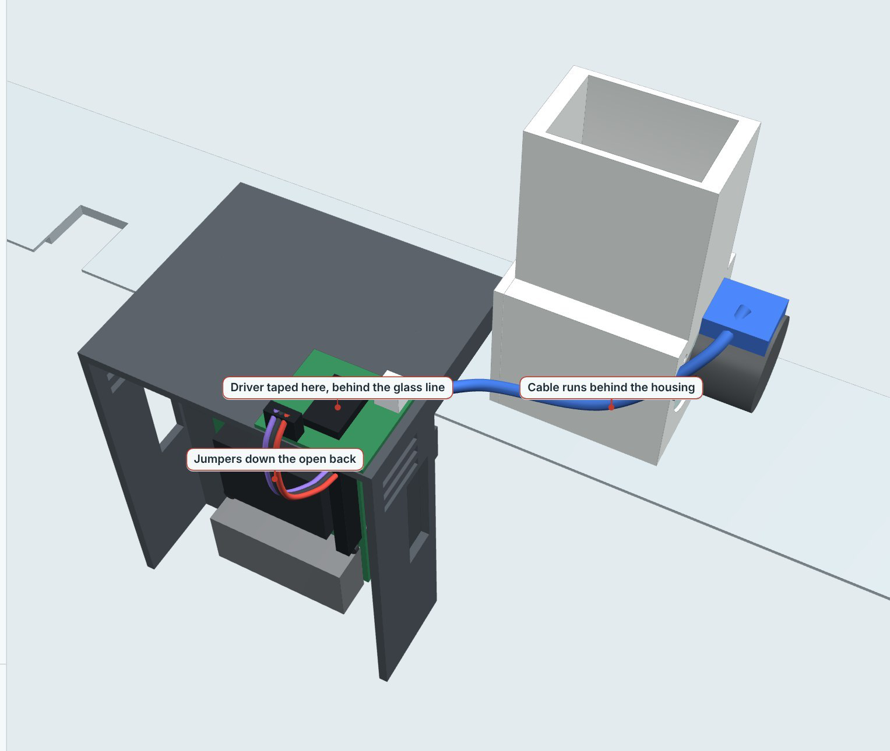
9. **Set it on the tank.** Lower it straight down onto the back of the tank. The
   step under the plate sits on the rear glass; the saddle leg and Pi hang
   behind. Lift by the plate, never by the hopper or the saddle.
   
10. **Test a feed.** Fill the hopper with micro pellets or granules, not flakes
    (flakes jam the drum). Keep the hopper dry; damp pellets clump.

</details>

## Camera mount (next build)

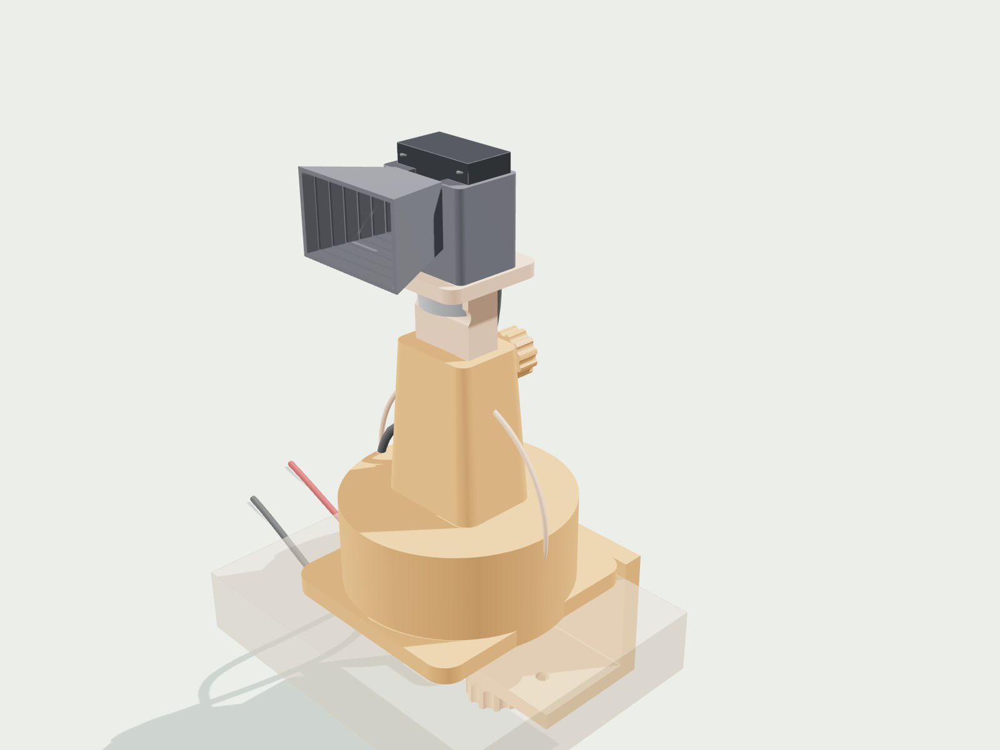

The Arducam's stock metal stand is too short to see the whole tank, so a printed
mount is designed and ready to print (v5, one combined KCL file): a clamp base
that grips the desk edge sideways instead of standing free, a telescoping post
with a height-lock knob, and a slide-in dock the camera cannot shake out of.

| Pod cutaway | Dock | Desk clamp |
|---|---|---|
| 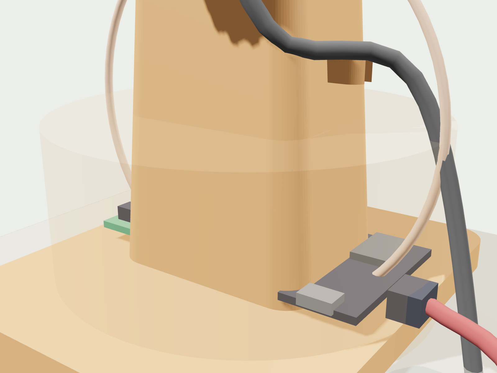 | 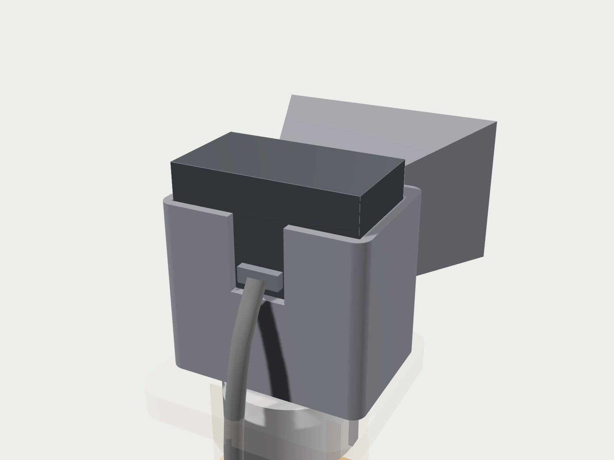 | 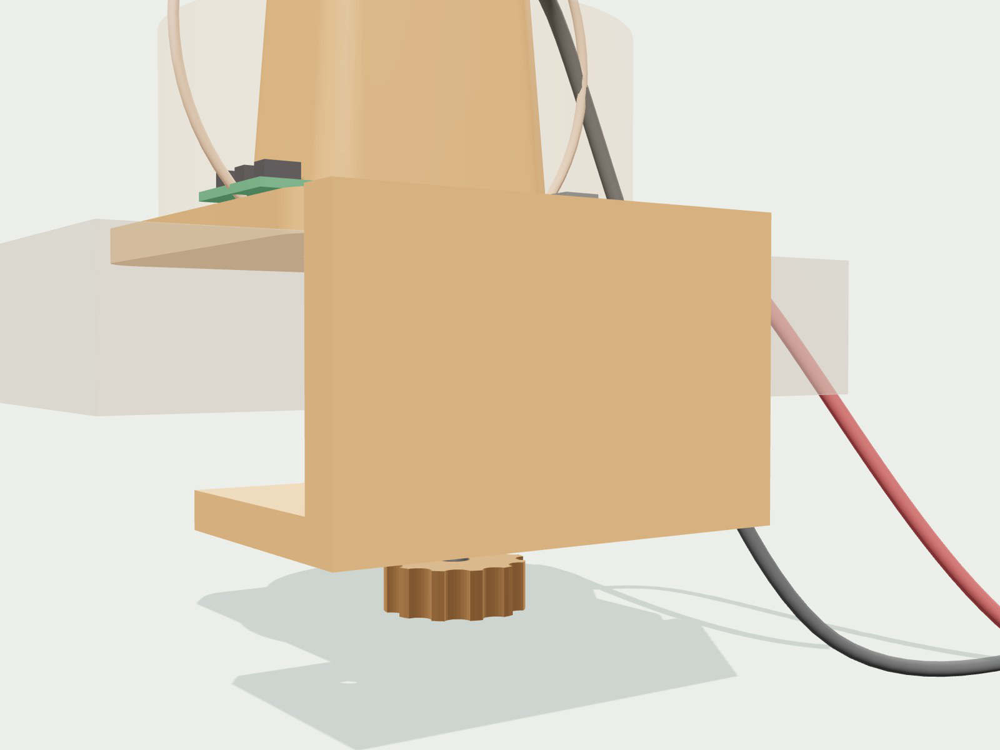 |

A motorized pan head is designed for a later revision: a second 28BYJ-48 and
driver sit stationary inside an enclosed pod in the base, driven by a spare
ESP32 over Wi-Fi and powered by one USB-C cable from the Pi. A shaft runs up the
column to a drum the camera rides on, giving about 350° of sweep with a soft
stop (the camera's own USB cable is what would otherwise wind up). That lets the
same camera pan between the tank and a second robot project on the floor behind
it.

## ESP32 nodes (planned)

Two ESP32 jobs are next, and both are drawn in the 3D layout above:

- **Water-quality node.** An ESP32 that lives dry behind the back glass in a
  small printed probe saddle next to the feeder, with only the probes in the
  water: a DS18B20 stainless temperature probe, a glass pH electrode on an
  analog conditioning board, and a float switch at the waterline. It reads
  every minute and publishes over Wi-Fi to an MQTT broker on the feeder Pi,
  which logs to SQLite, shows the latest values on the feed page, and alerts
  when temperature or pH leaves the safe band. Build stages: breadboard with
  the probes in a cup of tank water, protoboard inside the printed saddle, then
  a KiCad 2-layer PCB once the circuit has run for a month unchanged.
- **Camera pan head.** The second ESP32 drives the pan-head stepper in the
  camera mount's base pod, exposing a tiny HTTP endpoint the vision Pi calls.

Proposed pin map, MQTT topics, parts list and the stage plan are in
[`esp32/README.md`](esp32/README.md). Firmware is written against the
breadboard in stage 1, so nothing untested lands here.

## Machine learning

The tank is the deployment target for an ELE 588 (Applied Machine Learning)
course project on detecting unhealthy fish from appearance:

- Classical image features (colour histograms, LBP texture) from fish crops.
- Decision tree, kNN, SVM (RBF) and MLP classifiers in scikit-learn, trained on
  the public MatsyaDx-BD freshwater fish disease dataset, with ADASYN
  oversampling for the rare diseased classes.
- Three-tier evaluation: held-out dataset test set, healthy cherry barb crops
  from this tank for false-alarm rate, and barb crops with real lesion patches
  composited on as a sensitivity check.

YOLO on the Pi handles detection and cropping; the classifier runs on
full-resolution stills so each fish crop stays above the roughly 100 px minimum
the features need. The feeder's `feed.log` doubles as labelled feeding events
for a future behaviour classifier (dark / fed / normal) trained on the tank's
own logs.

## What went wrong and what fixed it

Almost every real problem came from the gap between the datasheet and the part
in hand.

| Problem | Fix |
|---|---|
| Zoo union unsupported for bodies that share only flat faces | Draw one closed multi-segment outline and extrude once |
| Zoo boolean subtract fails when a cutter face lands flush with an existing face | Overshoot into air or offset by 0.1 mm, use one L-shaped cutter, chain cuts one per step so the error points at a single cut |
| Motor ear holes too small for M4 screws | M3 × 12 with a filament shim (the print lab only stocks metric) |
| Drum D-slot did not account for the stepper's stepped shaft | Counterbore and collar relief in `drum.kcl`, verified against the real shaft |
| Driver board had no mount | Screw-mounted to the saddle back with 2 × M2.5 × 8 into plastic |
| Dose pocket (6 × 10 mm) held too much for eight small fish | Resized to 6 × 6 mm, confirmed by volume calculation |
| Pellets crushed in the unused part of the feed slot | Two ramp inserts funnel pellets into the pocket |
| Axle pin printed loose | Tape for now; CA glue or reprint at corrected diameter |
| Drum returned short of home | Step delay slowed from 1.5 ms to 2.5 ms; no PWM on coils while stepping |
| microSD card stalled ("card stuck being busy", I/O errors) | Boot the feeder Pi from a USB stick, boot order set to USB first |
| Hopper separate from housing kept coming loose | Fused into one body in v2 |

## Roadmap

**Working**

- All parts printed, drum fits the bore, cap and pin installed, motor mounted
  and turning.
- Pi 5 in the saddle, driver wired, homing repeatable at 2.5 ms per step.
- `feeder.py` with position memory and daily limits.
- Flask feed page with live camera stream, running as a service, reachable over
  Tailscale.
- Arducam stream with YOLOv8 boxes; feeder Pi booting from USB for reliability.

**Next**

- Glue or reprint the axle pin at the corrected size.
- Print and install the two ramp inserts and the hopper lid.
- Scheduled feeds (systemd timer calling `feed_once.py`).
- Pipe `feed.log` timestamps into the vision data collection as feeding-event
  labels.
- Print the camera mount v5 (measure desk thickness and camera case first), then
  add the pan head.
- ESP32 water-quality node on a breadboard, then protoboard, then PCB.
- Commit the `.kcl` and `.stl` sources and the geometry checker to `cad/`.

**Longer term**

- Cloud coordination: move the database and controller logic off the Pi so
  multiple nodes are coordinated centrally.
- Gaussian splat scan of the real tank with clickable part labels, served from
  the Pi and shown on a lab display.
- A gutted transparent LCD on the front glass showing live YOLO overlays.

## Repository layout

```
smart-fish-tank/
├── README.md
├── feeder/
│   ├── feeder.py              # interactive stepper control (the working core)
│   ├── feed_once.py           # one non-interactive feed (used by app.py and timers)
│   ├── app.py                 # phone feed page with embedded stream
│   ├── feederweb.service      # systemd unit for the feed page
│   ├── feed.timer.example     # scheduled feeds
│   ├── test.py                # wiring self-test
│   └── requirements.txt
├── vision/
│   ├── main.py                # MJPEG stream + YOLOv8 overlay + /analyze-tank
│   ├── stream.py              # stream-only server
│   ├── train.py               # YOLOv8 fine-tune on tank frames
│   ├── fish_description.py    # frame sampling + GPT description
│   ├── config/dataset.yaml
│   ├── templates/, static/
│   └── requirements.txt
├── esp32/
│   └── README.md              # water-quality node + pan head plan
├── cad/
│   └── README.md              # parts, dimensions, print settings, design history
└── docs/
    ├── Smart_Aquarium_Feeder_Overview.pdf   # the full project handoff
    ├── esp32_node_3d.html     # interactive three.js layout
    ├── make_architecture.py   # regenerates the architecture diagram
    ├── images/                # architecture, 3D still, build-guide renders
    └── photos/                # photos of the real build
```

## Security note

This repository contains **no credentials**. Pi passwords, Wi-Fi keys, router
logins, API tokens and Tailscale addresses are kept out of version control on
purpose; the OpenAI key for `/analyze-tank` comes from the `OPENAI_API_KEY`
environment variable only. If a secret is ever pushed, rotate it; scrapers find
tokens in public repos within minutes.

## Credits

Built by Mubariz Saeed in Dr. Yan Sun's CYPHER Lab at the University of Rhode
Island. Parts printed by the i² Studio at the Fascitelli Center for Advanced
Engineering. Cherry barbs, two nerite snails and a LANDEN 60P supplied the
requirements.
