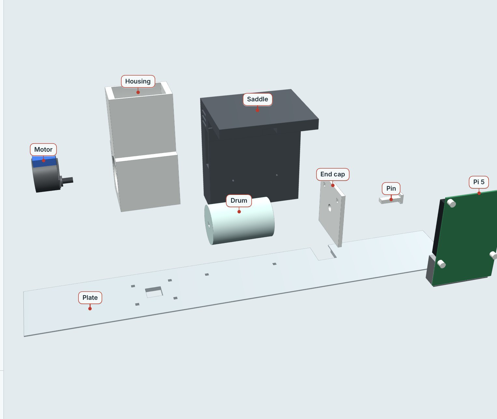

# CAD and 3D-printed parts

Every printed part was written as code in **KCL for Zoo Design Studio**
(zoo.dev), then printed in **PETG at 0.20 mm** at URI's i² Studio. The `.kcl`
source and exported `.stl` files belong in this folder so any part can be
rebuilt or reprinted from scratch (see "Still to commit" at the bottom).

> Design rule that shaped every part: **verify against the real hardware, not
> the datasheet.** The stepped motor shaft, the undersized motor ears, the loose
> axle pin, and the first oversized dose pocket were all caught by handling the
> printed parts, not by reading specs.



## Parts

| Part | Source file | Key dimensions | Print |
|---|---|---|---|
| Housing + hopper | `feeder.kcl` (body 1) | funnel hopper feeding a 40 mm slot over the drum bore | stand on motor end, bore vertical, tree supports under hopper |
| Drum | `drum.kcl` | Ø31.2 × 48 mm, 0.4 mm running clearance; D-hole 5.3 × 3.3 mm; dose pocket 6 × 6 mm (~0.09 g pellets); counterbore + collar relief for the stepped motor shaft | stand on end, no supports |
| End cap | `feeder.kcl` (body 3) | 40 × 46 × 3 mm, Ø6.2 mm bearing hole, two 2.6 mm pilots | flat |
| Axle pin | `feeder.kcl` (body 4) | 5.1 × 3.1 mm D shaft, 17 mm long, with head | flat; CA glue if loose |
| Saddle (Pi 5 bracket) | `saddle.kcl` | 100 mm wide bridge + hanging leg; Pi pocket open at the bottom; 15 × 6.5 mm wire tunnel; driver mounts on the back half of the bridge top | bridge flat on the bed, no supports |
| Rear cover plate | `plate.kcl` | 420 × 68 × 4 mm; 15 mm drop hole; 20 mm heater-cord notch; underside step sits on the back glass; doubles as the feeder mount | flat, on the Elegoo Giga bed |
| Hopper ramp inserts (×2) | `ramp.kcl` | wedge blocks, 50° slope, leaving a 7 mm opening right over the pocket so pellets stop getting crushed outside it | flat bottom on bed |
| Hopper lid | `feeder.kcl` | keeps the pellets dry | flat |
| Camera mount v5 | `camera_mount.kcl` | desk clamp base, telescoping post with height-lock knob, slide-in camera dock; pod in the base reserved for the pan-head stepper | designed, not yet printed |

Fasteners: M3 × 12 self-tapping (×8), motor ears M4 × 10 or M3 × 12 with a
filament shim (×2), Pi M2.5 × 10 with 5 mm nylon spacers (×4), driver board
M2.5 × 8 (×2). Tools: 2, 2.5 and 3 mm hex keys, CA glue. No soldering anywhere.

The motor's shaft is offset 8 mm from its body centre, so the drum bore sits at
Z = 26 mm to keep the motor body clear of the plate. The whole assembly lifts
off the tank as one unit by the plate.

## Design history

- **v1:** five loose bodies (housing, drum, end cap, axle pin, separate hopper)
  in one file, laid out side by side on the bed so nothing printed nested.
- **v2:** hopper fused to the housing (it kept coming loose), axle pin given a
  head, every joint switched from clearance holes to self-tapping pilot holes so
  the whole thing screws together and apart with hex keys. Consolidated to three
  files: `feeder.kcl`, `saddle.kcl`, `plate.kcl`.
- **Post-hardware revisions:** `drum.kcl` with a counterbore and collar relief
  for the motor's stepped shaft, `ramp.kcl` inserts for the hopper slot, a
  hopper lid, and the smaller 6 × 6 mm dose pocket.
- **Camera mount:** v5, one combined KCL file, pan-head pod designed for a
  later revision.

Two KCL gotchas that cost time: Zoo's union is unsupported for bodies that only
share flat faces (draw one closed multi-segment outline and extrude once), and a
boolean subtract fails when a cutter face lands flush with an existing face
(overshoot into air or offset by 0.1 mm, use one L-shaped cutter, and chain cuts
one per step so the error points at a single cut).

## Geometry checking before printing

Rather than discover collisions on the printer, the KCL files were parsed in
Python and rebuilt as real solids with `manifold3d` and `trimesh`. The checker
confirms each body is a single connected piece, intersects bodies pairwise to
find collisions, and reports bounding boxes for fit. It caught four real
problems before any plastic was used:

1. The Pi board poked 3.5 mm through the floor of the saddle pocket.
2. The side window for the Pi's ports was misaligned.
3. The motor's wire box collided with the plate.
4. Wall thickness around the M4 pilot holes was too thin.

```bash
pip install manifold3d trimesh
python3 ../tools/geometry_check.py   # once committed, see below
```

STLs were sanity-checked in Blender (scene units in millimetres, "separate by
loose parts" to confirm the body count) and sliced in Bambu Studio.

## Printing

Bambu P1S and H2D for everything except the 420 mm plate, which needed the
Elegoo Orange Storm Giga bed. All PETG, 0.20 mm layers.

| Part | Orientation | Supports |
|---|---|---|
| Housing + hopper | standing on the motor end, bore vertical | tree supports under the hopper |
| Drum | standing on end | none |
| End cap, pin, ramps, lid | flat | none |
| Saddle | bridge flat on the bed | none |
| Plate | flat (Giga bed) | none |

## Dose sizing

One dose for eight small cherry barbs is about **0.09 g**, which is the
6 × 6 mm pocket (~144 mm³). Target intake is 0.15 to 0.3 g per day, so two
feeds a day. The first drum used a 6 × 10 mm pocket (~0.2 g) and overfed. Two
weeks of food is only ~2.5 g, so the hopper has plenty of room. Use **micro
pellets, not flakes** (flakes jam the drum and go soggy); shake pellets in a
strainer before filling to knock out the dust that clumps and causes jams.

## 3D views

- Interactive layout of the whole tank, including the planned ESP32 nodes:
  [`../docs/esp32_node_3d.html`](../docs/esp32_node_3d.html) (three.js, opens
  in any browser).
- Build-guide renders, one per assembly step:
  [`../docs/images/renders/`](../docs/images/renders/).

## Still to commit

- Every `.kcl` and the exported `.stl` files (they live on the design machine;
  copy them here as `cad/*.kcl` and `cad/stl/`).
- `tools/geometry_check.py`, the manifold3d + trimesh checker described above.
- Gaussian splat scan of the real tank (Scaniverse capture, SuperSplat cleanup,
  a self-contained WebGL viewer page served from the Pi) for the lab display.
- KiCad 2-layer PCB to replace the ESP32 breadboard once the circuit is proven.
